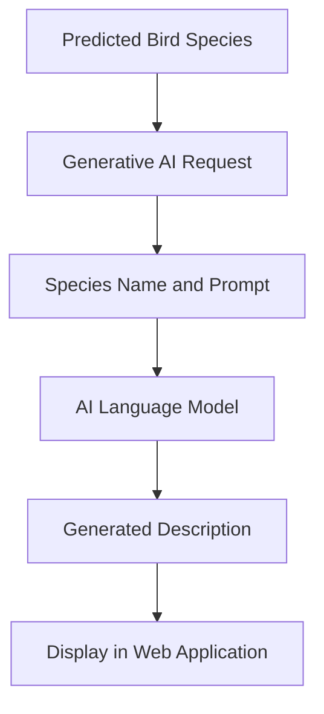
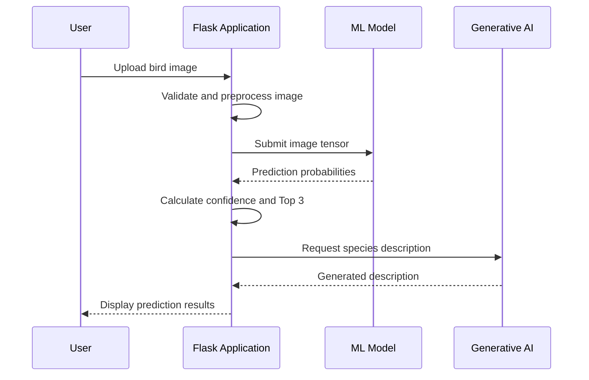

# bird-species-identification-ml-genai
AI-powered bird species identification using MobileNetV2, TensorFlow, Flask, and Generative AI.

## 1. Overview

Bird Species Identification Using Machine Learning and Generative AI is an intelligent image classification web application designed to identify bird species from uploaded images.

The system uses a deep learning model based on MobileNetV2 to classify bird images into 525 species categories. It analyzes the visual characteristics of an input image and generates a prediction with a confidence score. The application also displays the top three predicted species to provide alternative classification results.

Generative AI is integrated into the application to produce informative descriptions of the identified bird species, including physical characteristics, habitat, behavior, feeding habits, and interesting facts.

The application is developed using Python, TensorFlow, Keras, Flask, HTML, and CSS, combining deep learning-based image recognition with an interactive web interface.


## 2. Problem Statement

Bird species identification is a challenging task because many bird species share similar physical characteristics, colors, patterns, and body shapes. Manual identification requires domain knowledge and careful observation of distinguishing features.

Traditional identification methods may be time-consuming and difficult for users who lack expertise in ornithology.

The objective of this project is to develop an automated bird identification system that can analyze bird images, classify species using deep learning, and provide additional information through Generative AI.


## 3. Objectives

The primary objectives of the project are:

- Develop an automated bird species classification system.
- Implement deep learning-based image recognition.
- Classify images across 525 bird species.
- Apply image preprocessing to improve model input consistency.
- Display prediction confidence scores.
- Generate the top three classification results.
- Integrate Generative AI for species information.
- Develop a web-based application using Flask.
- Provide an accessible and interactive user interface.
- Evaluate model performance using training and validation metrics.


## 4. Proposed System

The proposed system uses a trained MobileNetV2-based image classification model to recognize bird species from images.

The uploaded image is processed through a preprocessing pipeline that converts the image into RGB format, resizes it to 224 × 224 pixels, normalizes pixel values, and converts it into a numerical array suitable for model inference.

The trained model generates prediction probabilities for the supported bird species. The highest probability is selected as the primary prediction, and the top three probabilities are displayed to the user.

Generative AI is then used to generate an informative description of the predicted species.

### Main Components

- Image Upload: Accepts bird images from the user.
- Image Preprocessing: Converts, resizes, and normalizes the uploaded image.
- Deep Learning Classifier: Uses MobileNetV2 to classify bird species.
- Prediction Engine: Generates class probabilities and confidence scores.
- Top-3 Classification: Displays the three most probable classes.
- Generative AI: Produces bird species descriptions.
- Flask Application: Connects model inference and user interface.
- Web Interface: Displays images, predictions, confidence scores, and generated descriptions.


## 5. System Architecture

   Web Interface
   Upload Bird Image
   Flask Application
   Image Preprocessing
   MobileNetV2 Model
   Class Probabilities
   Top Prediction
   Top 3 Predictions
   Generative AI
   Species Description
   Results Dashboard
  
  
## Architecture Description

1. The user accesses the web application.
2. A bird image is uploaded through the web interface.
3. Flask receives the image and manages the prediction workflow.
4. The image is preprocessed into the model's required input format.
5. MobileNetV2 extracts image features and generates classification probabilities.
6. The prediction module identifies the most probable species.
7. The confidence score and top three predictions are calculated.
8. Generative AI generates a description of the predicted species.
9. The application displays the final results.


## 6. Technologies and Tools

Technology | Purpose |

 Python | Core programming language 
 TensorFlow | Deep learning model development and inference 
 Keras | Model building, training, and loading 
 MobileNetV2 | Image classification architecture 
 NumPy | Numerical processing and prediction arrays 
 Pillow (PIL) | Image loading and image manipulation 
 Flask | Backend web application framework 
 HTML5 | Web page structure 
 CSS3 | User interface styling 
 OpenAI API | Generative AI-based species descriptions 
 PyCharm | Development environment 
 Git | Version control 
 GitHub | Source code hosting and project documentation 


## 7. Dataset

The project uses a bird image dataset containing 525 distinct species categories.

The dataset is organized according to bird species labels, allowing the model to learn visual differences among classes.

### Dataset Characteristics

 525 bird species classes
 Bird images collected and organized by species
 RGB image inputs
 Training and validation datasets
 Diverse visual features
 Different poses, orientations, backgrounds, and lighting conditions

### Dataset Preparation

The dataset preparation pipeline includes:

1. Loading images from the dataset directory.
2. Assigning class labels to species folders.
3. Resizing images to a consistent dimension.
4. Normalizing pixel values.
5. Separating training and validation data.
6. Applying data augmentation to training images.

The dataset is used to train the deep learning model for multiclass bird classification.

## 8. Deep Learning Model

### MobileNetV2

MobileNetV2 is a lightweight convolutional neural network architecture developed for efficient computer vision tasks.

It uses depthwise separable convolutions and inverted residual blocks to reduce computational cost while maintaining useful image feature representations.

In this project, MobileNetV2 is used as the foundation of the bird species classification model.

### Why MobileNetV2?

 Efficient computation
 Suitable for image classification
 Lightweight architecture
 Strong feature extraction capability
 Reduced computational requirements compared with many larger architectures
 Suitable for transfer learning workflows

### Model Classification Process

1. Input bird image.
2. Image preprocessing.
3. Feature extraction.
4. Deep learning classification.
5. Probability generation for each species.
6. Selection of the highest-probability class.
7. Confidence score calculation.
8. Top-three predictions generation.

## 9. Image Preprocessing

Image preprocessing ensures that input images have a consistent representation before being passed into the deep learning model.

### Preprocessing Steps

 Load the image.
 Convert to RGB color format.
 Resize to 224 × 224 pixels.
 Convert the image into a NumPy array.
 Normalize pixel values.
 Expand the dimensions to create a batch.
 Pass the image to the model.

### Input Dimensions

Height:       224
Width:        224
Color:        RGB
Channels:      3
Input shape:  (1, 224, 224, 3)


### Example Preprocessing Code

python
from PIL import Image
import numpy as np

def preprocess_image(image_path):
    image = Image.open(image_path).convert("RGB")
    image = image.resize((224, 224))

    image_array = np.array(image, dtype=np.float32)
    image_array = image_array / 255.0

    image_array = np.expand_dims(image_array, axis=0)

    return image_array

The function converts an image into a normalized batch that can be passed to the classification model.


## 10. Data Augmentation

Data augmentation is used to introduce variations into training images and improve the model's ability to generalize to new images.

The augmentation pipeline may include:

 Random horizontal flipping
 Random rotation
 Random zoom
 Image transformations

### Benefits of Data Augmentation

 Reduces overfitting
 Improves image diversity
 Helps the model learn more robust visual features
 Supports better generalization to different image orientations and conditions


## 11. Model Training Workflow

The model training pipeline includes the following stages:

1. Load the bird species dataset.
2. Extract class labels.
3. Prepare training and validation datasets.
4. Resize and normalize images.
5. Apply data augmentation to training images.
6. Configure the MobileNetV2-based classifier.
7. Train the model using the training dataset.
8. Monitor training and validation accuracy.
9. Monitor training and validation loss.
10. Save the trained model.
11. Load the saved model into the Flask application.

### Training and Validation

The model is evaluated during training using training and validation datasets.

Training accuracy measures the model's performance on the data used to optimize the model.

Validation accuracy measures its performance on a separate validation subset used during model development.

The project reports training/validation performance. Independent test accuracy is not claimed because a separate held-out test evaluation has not been established.


## 12. Model Evaluation

The model's performance is monitored using accuracy and loss during training and validation.

### Recorded Accuracy

 Training Configuration | Accuracy
 Initial model training | 89.2% 
 Training configuration with augmentation | 91.8% 

These values represent the accuracy recorded during training and validation. They are not independent test-set results.

### Evaluation Metrics

The project can use the following metrics for further evaluation:

 Accuracy
 Precision
 Recall
 F1-score
 Confusion matrix
 Training loss
 Validation loss

A separate test dataset should be used for final unbiased performance evaluation.


## 13. Prediction and Confidence Score

The trained model produces a probability score for each bird species class.

The predicted species is selected by identifying the class with the highest probability.

### Prediction Logic

python
import numpy as np

predictions = model.predict(processed_image)

predicted_index = np.argmax(predictions[0])

confidence = float(predictions[0][predicted_index]) * 100

predicted_species = labels[predicted_index]

print("Predicted Species:", predicted_species)
print("Confidence:", round(confidence, 2), "%")


### Explanation

- `model.predict()` generates the classification probabilities.
- `np.argmax()` identifies the index with the highest probability.
- The index is mapped to the corresponding species label.
- The probability is converted into a percentage for display.


## 14. Top Three Predictions

The application displays the three highest-probability species predictions.

### Example Code

```python
top3_indices = predictions[0].argsort()[-3:][::-1]

top3_predictions = [
    (
        labels[index],
        round(float(predictions[0][index]) * 100, 2)
    )
    for index in top3_indices
]

for species, confidence in top3_predictions:
    print(f"{species}: {confidence}%")
```

### Example Output

```text
Prediction Results

1. Indian Peafowl - 94.72%
2. Green Peafowl - 3.86%
3. Blue Pitta - 0.91%
```

The species names and confidence values above are illustrative only.

## 15. Generative AI Integration

Generative AI is integrated to enhance the classification application by providing natural-language information about the predicted bird species.

After the model predicts a species, the species name is provided to the Generative AI component, which generates a readable description.

### Information Generated

- Species overview
- Physical appearance
- Habitat
- Diet and feeding behavior
- Behavioral characteristics
- Interesting facts
- Ecological importance

### Workflow



Generative AI is used for information generation rather than image classification. The species prediction itself is performed by the trained deep learning model.

Generated information may be inaccurate and should be verified using reliable sources.


## 16. Flask Web Application

Flask is used to develop the backend web application and connect the user interface with the trained deep learning model.

### Backend Responsibilities

- Handle user login
- Receive uploaded images
- Validate image file types
- Store uploaded images
- Preprocess input images
- Perform model inference
- Generate confidence scores
- Extract top-three predictions
- Request AI-generated descriptions
- Return prediction results to the web page

### Application Workflow




## 17. Application Output

The application displays:

- Uploaded bird image
- Predicted species name
- Confidence percentage
- Top three predictions
- AI-generated bird description

The output is presented through the web interface to make the prediction results easy to understand.


### File Descriptions

 File / Folder | Description 

 app.py | Flask application, login, upload, prediction workflow 
 utils.py | Image preprocessing, label loading, AI description helper 
 model.keras | Trained deep learning classification model 
 labels.txt | Species class names 
 requirements.txt` | Python dependency list 
 .env | Environment variables and API key configuration 
 templates/ | HTML templates 
 static/ | CSS, images, and uploaded files 
 static/uploads/ | Uploaded image storage 
 README.md | Project documentation 

The structure may be adjusted to match the actual files in the repository.

## 19. Installation and Setup

### Prerequisites

- Python 3.10
- PyCharm
- Git
- Web browser
- Compatible TensorFlow environment
- OpenAI API key (if Generative AI features are enabled)


### User Instructions

1. Open the application in the browser.
2. Log in using the configured login credentials.
3. Select a bird image from the computer.
4. Submit the image for classification.
5. Wait for the model to process the image.
6. View the predicted bird species.
7. Review the confidence score and top three predictions.
8. Read the AI-generated species description.

## 21. Security Considerations

Security practices for this application include:

- API keys stored in environment variables
- Validation of uploaded file types
- Secure filename handling
- File upload size restrictions
- Avoiding public exposure of secrets
- Avoiding unnecessary access to uploaded files
- Configuring Flask secrets appropriately
- Replacing demonstration login credentials before deployment

For production deployment, authentication, session security, rate limiting, input validation, API security, and secure file storage should be strengthened.


## 22. Advantages

- Automated bird species identification
- Supports 525 species categories
- Deep learning-based image recognition
- Efficient MobileNetV2 architecture
- Prediction confidence score
- Top-three alternative predictions
- Generative AI-based information enhancement
- Interactive web application
- Combines computer vision and natural language generation
- Accessible through a browser-based interface


## 23. Limitations

- Classification is limited to the trained species categories.
- Prediction accuracy depends on image quality.
- Visually similar bird species may be confused.
- Poor lighting, blurry images, occlusion, and unusual angles may affect predictions.
- Model confidence is not a guarantee of correctness.
- Training and validation accuracy do not establish real-world generalization.
- AI-generated species descriptions may contain factual inaccuracies.
- The model requires compatible runtime dependencies and hardware resources.


## 24. Future Enhancements

- Real-time bird recognition using camera input
- Bird species identification through bird sounds
- Mobile application development
- Location-aware species information
- Improved model accuracy and generalization
- Independent test-set evaluation
- Explainable AI integration
- Prediction history and user profiles
- Cloud deployment
- Offline prediction capability
- Expanded species dataset
- Bird migration and conservation information integration


## 25. Project Information

 Attribute | Details 
 Project Title | Bird Species Identification Using Machine Learning and Generative AI
 Domain | Artificial Intelligence and Machine Learning 
 Application Area | Computer Vision 
 Model Architecture | MobileNetV2 
 Framework | TensorFlow / Keras 
 Number of Classes | 525 Bird Species 
 Backend | Flask 
 Frontend | HTML, CSS 
 Generative AI | OpenAI API 
 Programming Language | Python 
 Project Type | Academic and Portfolio Project 


